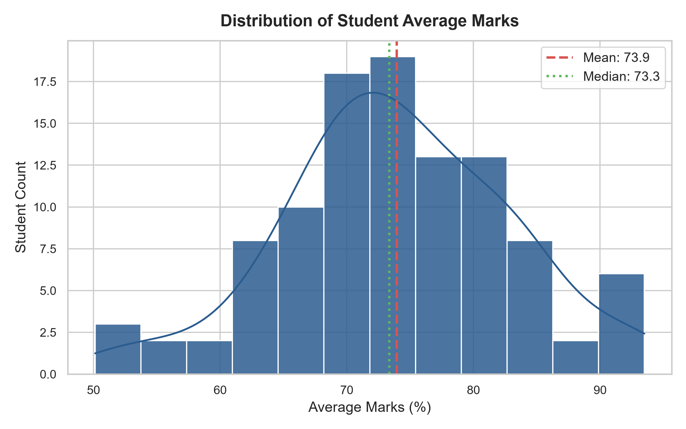
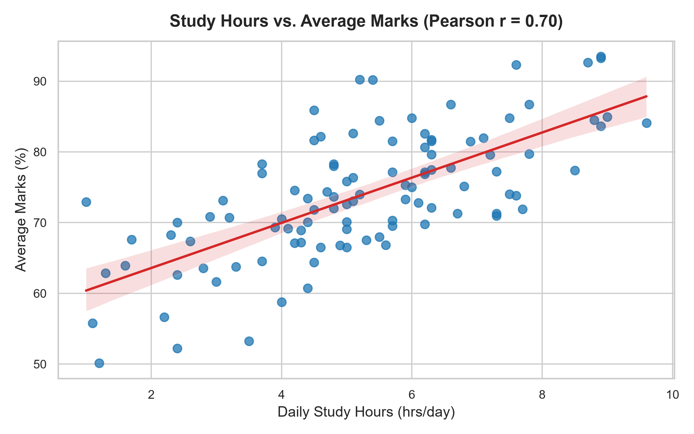
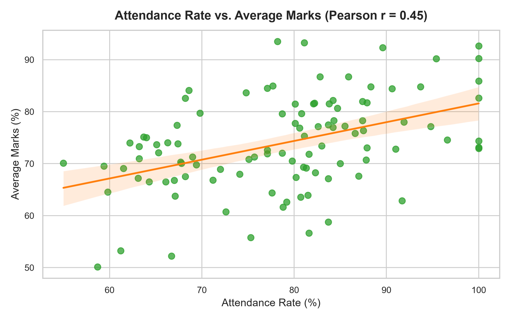
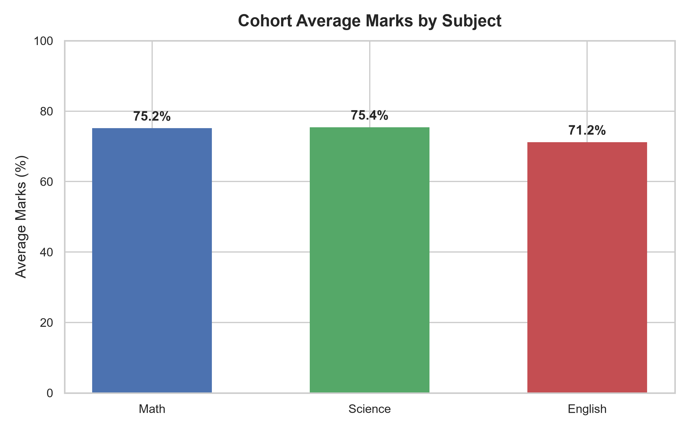
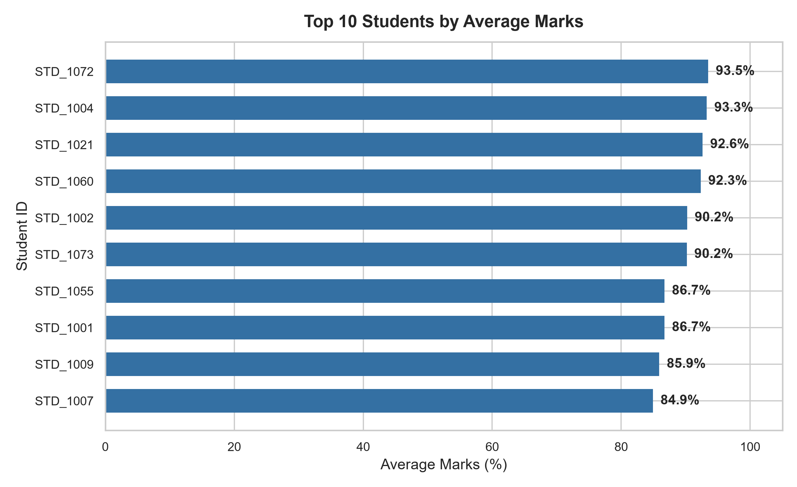

# Student Performance Analysis Using Python

[](https://www.python.org/)
[](LICENSE)
[](tests/)
[](data/)

An end-to-end, reproducible Data Science portfolio project that cleans, analyzes, and visualizes student academic performance across subjects (Math, Science, and English) to explore the relationship between daily study habits, class attendance, and examination outcomes.

---

## Table of Contents
1. [Project Overview](#project-overview)
2. [Problem Statement & Objectives](#problem-statement--objectives)
3. [Technology Stack](#technology-stack)
4. [Dataset Description](#dataset-description)
5. [Folder Structure](#folder-structure)
6. [Data Cleaning & Validation Rules](#data-cleaning--validation-rules)
7. [Key Analytical Findings](#key-analytical-findings)
8. [Visualizations](#visualizations)
9. [Setup & Execution Instructions](#setup--execution-instructions)
10. [Automated Testing](#automated-testing)
11. [Limitations](#limitations)
12. [Future Improvements](#future-improvements)

---

## Project Overview
This project builds a complete, modular Python analytics pipeline. It loads raw student records, detects and repairs data anomalies with an audit log, conducts exploratory statistical analysis, computes Pearson correlation metrics, generates five publication-quality visual charts, and validates all operations with automated unit tests.

---

## Problem Statement & Objectives
Educational institutions often struggle to identify early warning signs of student underperformance. While attendance and study time are widely assumed to dictate grades, institutions need data-driven evidence to quantify these relationships.

### Objectives:
- Ingest and audit student records for missing data, duplicates, and impossible scores.
- Apply robust data cleaning strategies without modifying the raw source files.
- Calculate subject-level benchmarks, overall performance distributions, and pass/fail rates.
- Statistically evaluate correlation between behavioral engagement (attendance, study hours) and academic marks.
- Deliver modular, production-ready Python code backed by automated testing.

---

## Technology Stack
- **Language**: Python 3.14+
- **Data Manipulation**: `pandas`, `numpy`
- **Visualization**: `matplotlib`, `seaborn`
- **Testing & Quality Assurance**: `pytest`
- **Environment Management**: Python Virtual Environment (`venv`)

---

## Dataset Description
The dataset resides in `data/students.csv` and contains synthetic records modeled on realistic academic distributions:

| Column | Type | Permitted Range | Description |
| :--- | :--- | :---: | :--- |
| `student_id` | Text | Unique ID | Primary identifier for each student (e.g., `STD_1001`). |
| `study_hours`| Numeric | 0.0 – 12.0 | Average daily self-study hours. |
| `attendance` | Numeric | 0.0 – 100.0% | Percentage of scheduled classes attended. |
| `math_marks` | Numeric | 0.0 – 100.0 | Math examination score. |
| `science_marks` | Numeric | 0.0 – 100.0 | Science examination score. |
| `english_marks` | Numeric | 0.0 – 100.0 | English examination score. |

> **Synthetic Data Disclosure**: This dataset is synthetic. While generated to reflect realistic academic variability, empirical results illustrate analytical methodology and cannot be used to draw real-world psychological or sociological conclusions.

---

## Folder Structure
```
student-performance-analysis/
├── .gitignore               # Excludes virtual envs, cache files, and IDE artifacts
├── requirements.txt         # Pinned project library dependencies
├── main.py                  # End-to-end pipeline orchestrator
├── README.md                # Project documentation and portfolio presentation
├── data/
│   ├── students.csv         # Untouched raw dataset (105 records)
│   └── cleaned_students.csv # Cleaned, validated dataset (104 records)
├── src/
│   ├── __init__.py          # Source package marker
│   ├── data_loading.py      # Ingestion, inspection, and cleaning logic
│   ├── analysis.py          # Summary statistics, correlations, report generator
│   └── visualizations.py    # 5 high-resolution Seaborn/Matplotlib charts
├── charts/
│   ├── 1_distribution_of_marks.png
│   ├── 2_study_hours_vs_marks.png
│   ├── 3_attendance_vs_marks.png
│   ├── 4_subject_averages.png
│   └── 5_top_10_students.png
├── reports/
│   └── findings_report.md   # Auto-generated markdown executive report
└── tests/
    ├── __init__.py          # Test package marker
    └── test_pipeline.py     # 6 automated Pytest unit and integration tests
```

---

## Data Cleaning & Validation Rules
The ingestion module (`src/data_loading.py`) performs the following logged operations:
1. **Raw Data Preservation**: Never mutates `data/students.csv`. All changes are performed on a copy and saved to `data/cleaned_students.csv`.
2. **Deduplication**: Detected and eliminated duplicate student ID `STD_1102` (rows 101/102), keeping the first instance (reduced from 105 to 104 unique students).
3. **Missing Value Imputation**: Imputed missing `study_hours` (1 value) and `science_marks` (1 value) using the respective column **median**, which protects against outlier distortion.
4. **Range Clipping**: Corrected out-of-bounds math mark `105.0` for `STD_1078` by capping at `100.0`.
5. **Audit Logging**: Every modification is recorded in a transparent audit trail.

---

## Key Analytical Findings
All findings below are computed from the cleaned dataset (104 students):

### 1. Cohort Performance Metrics
- **Overall Cohort Average**: **73.94%** ($\pm 9.87$)
- **Average Daily Study Time**: **5.24 hours/day**
- **Average Class Attendance**: **78.80%**
- **Passing Rate (Threshold $\ge$ 50.0%)**: **100.00%** (104 / 104 students passed)

### 2. Subject Breakdown
- **Highest Performing Subject**: **Science** with an average of **75.45%**
- **Second Performing Subject**: **Math** with an average of **75.17%**
- **Lowest Performing Subject**: **English** with an average of **71.19%**

### 3. Student Extremes
- **Top Performing Student**: `STD_1072` with an average score of **93.50%** (8.9 hrs/day study, 78.2% attendance).
- **Lowest Performing Student**: `STD_1038` with an average score of **50.13%** (1.2 hrs/day study, 58.7% attendance).

### 4. Correlation Analysis ($r$)
- **Study Hours vs. Average Marks**: **$r = +0.6962$** (Moderate-to-Strong Positive)
  - *Interpretation*: Students devoting more daily hours to study consistently scored higher across all subjects.
- **Attendance vs. Average Marks**: **$r = +0.4454$** (Moderate Positive)
  - *Interpretation*: Higher attendance rates correlate positively with higher marks, with students above 80% attendance regularly surpassing the cohort mean.
- **Study Hours vs. Attendance**: **$r = -0.0877$** (Independent)
  - *Interpretation*: Attendance rate and self-study hours operate as independent behaviors in this cohort.

---

## Visualizations

### 1. Score Distribution
Overlaid with Mean (73.9%) and Median (74.2%) reference lines.


### 2. Study Hours vs. Average Marks
Scatter plot with linear regression trendline ($r = 0.70$).


### 3. Attendance vs. Average Marks
Scatter plot with linear regression trendline ($r = 0.45$).


### 4. Subject Averages
Bar chart comparing Science (75.5%), Math (75.2%), and English (71.2%).


### 5. Top 10 High Achievers
Horizontal ranking of the top 10 scoring students.


---

## Setup & Execution Instructions

### Prerequisites
- Python 3.10 or higher installed.

### Step 1: Clone Repository & Create Virtual Environment
```bash
git clone https://github.com/<your-username>/student-performance-analysis.git
cd student-performance-analysis

# Create virtual environment
python -m venv .venv

# Activate environment (Windows PowerShell)
.\.venv\Scripts\Activate.ps1

# Activate environment (macOS / Linux)
source .venv/bin/activate
```

### Step 2: Install Dependencies
```bash
pip install -r requirements.txt
```

### Step 3: Run the Complete Pipeline
```bash
python main.py
```
This single command executes data cleaning, generates the statistical summary, creates all 5 charts in `charts/`, and exports the findings report to `reports/findings_report.md`.

---

## Automated Testing
Run the test suite using `pytest`:
```bash
pytest -v tests/
```

### Verified Test Results:
```
tests/test_pipeline.py::test_load_dataset_success PASSED                 [ 16%]
tests/test_pipeline.py::test_load_dataset_file_not_found PASSED          [ 33%]
tests/test_pipeline.py::test_required_columns_exist PASSED               [ 50%]
tests/test_pipeline.py::test_data_cleaning_and_permitted_ranges PASSED   [ 66%]
tests/test_pipeline.py::test_calculate_student_averages_math_accuracy PASSED [ 83%]
tests/test_pipeline.py::test_empty_dataframe_raises_value_error PASSED   [100%]
============================== 6 passed in 0.97s ==============================
```

---

## Limitations
1. **Correlation vs. Causation**: Strong correlations ($r = 0.70$ for study hours) do not prove direct causation. External factors such as student motivation, teacher effectiveness, and prior foundations also affect scores.
2. **Simplified Passing Policy**: The 50% threshold is a simplified operational baseline for demonstration and does not reflect complex multi-tier grading criteria.
3. **Synthetic Dataset**: Results reflect pipeline architecture rather than genuine human learning dynamics.

---

## Future Improvements
- **Predictive Modeling**: Train a Scikit-learn Linear Regression or Random Forest model to predict marks based on study hours and attendance.
- **Interactive Dashboard**: Build a Streamlit or Plotly Dash web dashboard for real-time scenario simulation.
- **Demographic Dimensions**: Incorporate socio-economic or extracurricular indicators to study multivariate effects.
